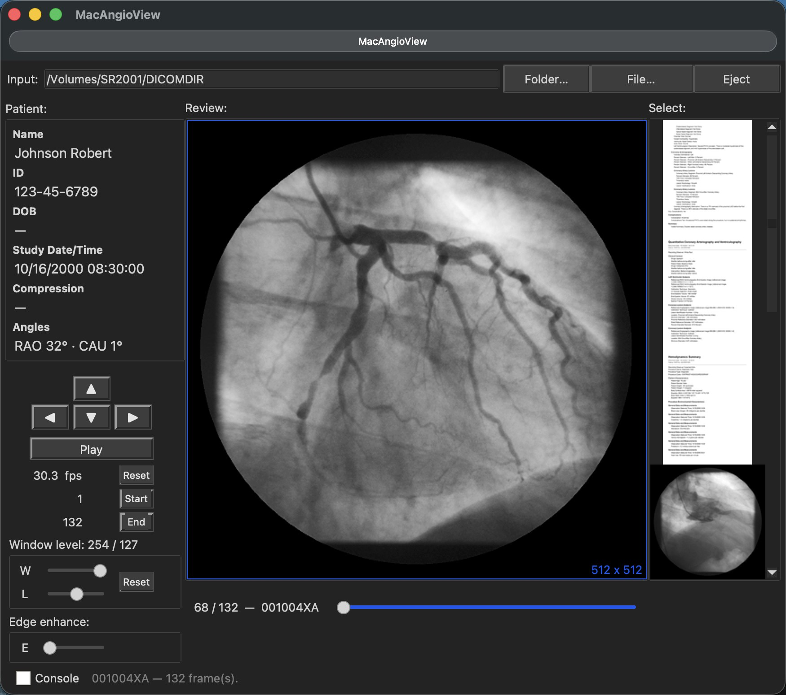

# MacAngioView

**A DICOM cine viewer** — play back cardiac catheterization
angiography (XA) runs and multiframe ultrasound (US) loops from study CDs,
disks, or exported folders.

🌐 **Website:** [macangioview.com](https://macangioview.com)
🍎 **Mac:** MacAngioView continues as [CardiacStudy Player on the Mac App Store](https://apps.apple.com/app/id6824492948)
⬇️ **Windows:** [MacAngioView-Windows.zip](https://github.com/wlapointe/MacAngioView/releases/latest/download/MacAngioView-Windows.zip) (free beta)

## Features

- **DICOM XA / RF playback** — multi-frame cine-angiogram and
  radiofluoroscopic runs, including lossless-JPEG compressed studies from
  cardiac catheter X-ray systems
- **Multiframe ultrasound (US)** — echo and vascular ultrasound cine loops
  play back the same way as angiography runs
- **CT/CTA series** — a study's CT slices are grouped into one browsable
  stack, ordered by their true position in the patient rather than by file
  numbering, and stepped slice by slice; a series holding several
  reconstructions or cardiac phases opens as one stack each, with a Preset
  picker for multi-valued window/level (soft tissue, bone, lung)
- **MR series** — MR studies are read alongside the rest of a patient's
  imaging and grouped into browsable stacks in anatomical order; a sequence
  acquired at more than one echo opens as one stack per echo
- **Broad compatibility** — reads studies exported from many cath-lab,
  ultrasound, and CT imaging systems; just open a study CD or folder
- **Frame-by-frame review** — step through frames, adjust playback speed, and
  jump to any run by name from the Select menu
- **DSA subtraction** — view angiograms with the standing anatomy subtracted
  away, automatically or from a manually picked mask frame
- **Export** — save cine runs as standard movie files for presentations and
  teaching; exports and copied frames match what you see, including zoom
- **Reports & waveforms** — view a study's encapsulated PDF reports, DICOM
  Structured Reports (cath, QCA, hemodynamics, ECG summaries), and Waveform
  Storage instances (12-lead ECG, hemodynamic, cardiac EP) rendered as
  calibrated lead-strip pages, alongside the imaging
- **Quiz Mode** — a self-study workflow that hides a study's own report until
  you're ready, then lets you record your own findings and check them
  against it
- **Caliper Tool** — two-click mm distance measurement, calibrated
  automatically from ultrasound region or XA beam geometry, or manually from
  a catheter shaft
- **Native-resolution viewport** — every study renders at its own pixel
  resolution in a freely resizable window; drag or two-finger swipe to roam,
  Cmd + scroll to zoom under the cursor (the scroll wheel on Windows), drag a
  box to magnify a region, double-click to toggle actual size and fit to
  window
- **Presentation States** — reads a study's saved annotated views (GSPS): the
  window, crop, and circle/ellipse/text markup recorded on an image, shown as
  its own page with the unmarked original still available
- **Discs without an index** — a folder of DICOM files with no DICOMDIR opens
  as one study

## Requirements

- Mac — [CardiacStudy Player](https://apps.apple.com/app/id6824492948) from the Mac App Store; macOS 15 (Sequoia) or later, universal
- Windows — Windows 10 or 11, 64-bit
- DICOM XA or multiframe US studies on CD, disk, or folder

## Mac

On the Mac, MacAngioView continues as **CardiacStudy Player** on the
[Mac App Store](https://apps.apple.com/app/id6824492948): a one-time purchase
with free updates, and no beta expiry. It also reads the DICOM 2026 transfer
syntaxes (JPEG XL, Deflated Image Frame, Encapsulated Uncompressed).

Earlier Mac betas (`MacAngioView.dmg`) stay on the
[Releases](https://github.com/wlapointe/MacAngioView/releases) page. Each one
works until its expiry date on your Mac. To install one, double-click the
`.dmg` and drag **MacAngioView** onto **Applications**; it is signed and
notarized by Apple.

## Install (Windows)

1. Download [`MacAngioView-Windows.zip`](https://github.com/wlapointe/MacAngioView/releases/latest/download/MacAngioView-Windows.zip)
2. Right-click the zip, choose **Extract All…**, then open the extracted
   **MacAngioView** folder — don't run the `.exe` from inside Explorer's
   zip preview, which can drop the files the app needs alongside it
3. Double-click **MacAngioView.exe**

The Windows build isn't code-signed yet, so SmartScreen will show
"Windows protected your PC" on first launch — click **More info**, then
**Run anyway**.

## Support

Questions or feedback? Email [support@williamshillsoftware.com](mailto:support@williamshillsoftware.com).

---

> **Not for clinical use.** MacAngioView is intended for review and
> educational purposes. It is not certified as a medical device and must not
> be used for primary diagnosis or treatment decisions.
